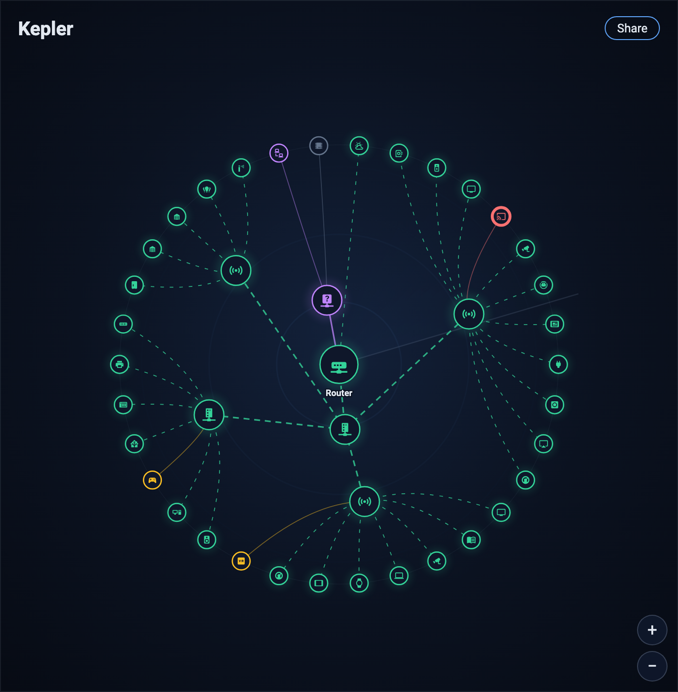
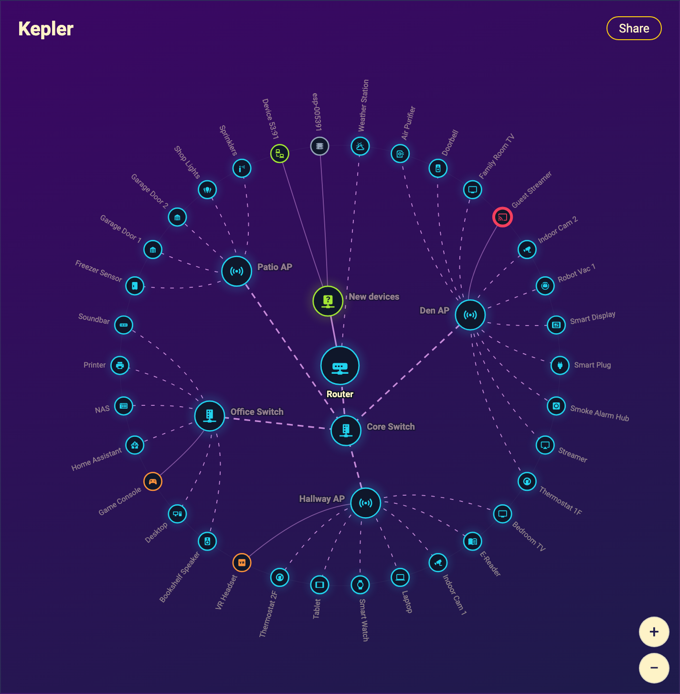
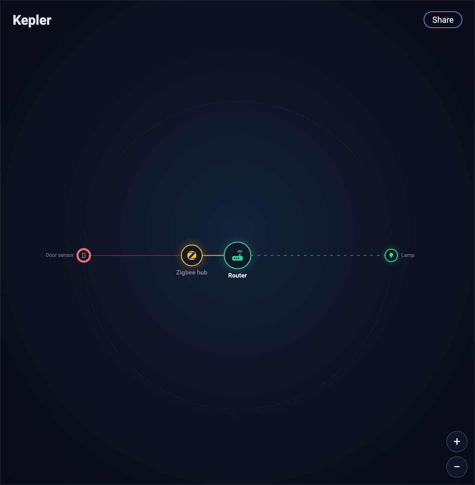
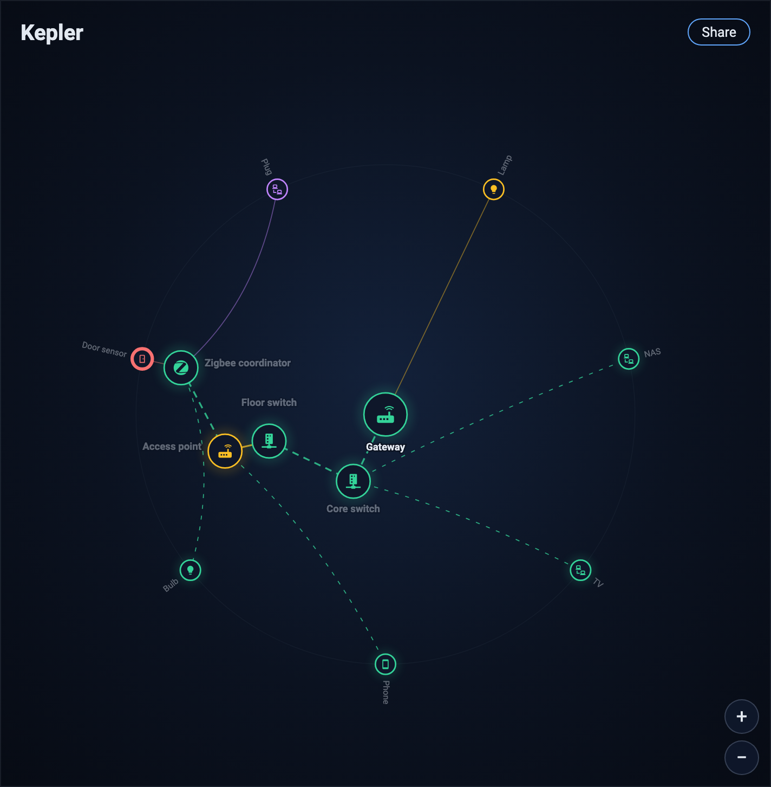

# kepler-card
Orbital map card for Home Assistant. Shows Zigbee, Z-Wave, Thread and Bluetooth meshes, or any device tree, as a live radial view.

| Themed | Small tree | Deep tree |
| --- | --- | --- |
|  |  |  |

The images in `docs/` are rendered from the preview page: run `npm run render` (needs `npx playwright install chromium`) and commit the result.

## Keyboard

Press Tab and Shift+Tab to move between nodes. The focused node is outlined and shows its label. Enter or Space activates it and fires the same `kepler-node-tap` event as a click (and opens more-info when `more_info` is on). With zoom on, a focused node is panned into view.

## CI

Pull requests and pushes to main run `.github/workflows/ci.yml`:

- HACS validation (category `plugin`). HACS finds the card in the committed `dist/kepler-card.js`, so no tag or release is needed for the check. The job rebuilds and fails if `dist/kepler-card.js` differs from the fresh build, so run `npm run build` and commit `dist/` after changing `src/`. The root `kepler-card.js` stays an uncommitted build output used by tests and e2e. HACS also needs the GitHub repository description and topics set; that is a repo setting the workflow does not do.
- Unit tests (`npm test`, which builds first).
- Playwright browser tests in chromium and WebKit (`npm run test:browser`). Either browser failing fails the job.
- Home Assistant end-to-end tests against a pinned release, which blocks the merge, and against the beta, which does not. The pinned tag lives in `ha-version.txt`.
